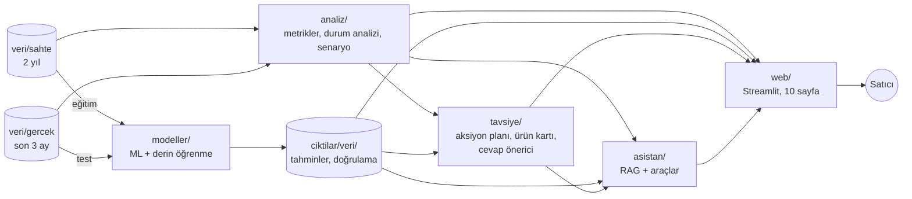
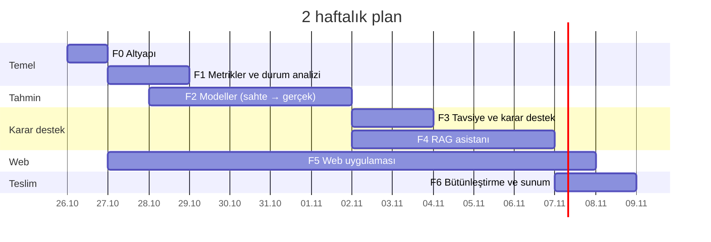
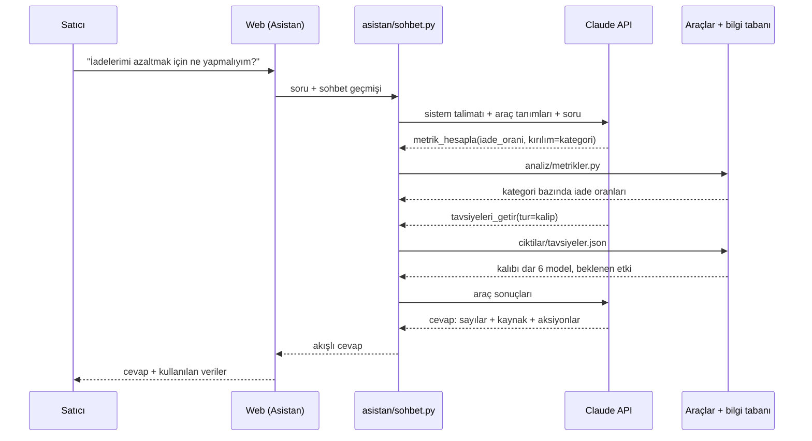

# Proje Planı — Trendyol Satıcı Karar Destek Sistemi (2 hafta)

Bu doküman projenin yol haritasıdır: ne yapacağımızı, hangi gün ve sırayla yapacağımızı ve "bitti"nin ne demek olduğunu
tanımlar. Görev durumları buradaki tablolarda tutulur.

- **Şu an neredeyiz, kim ne yapıyor?** → [DURUM.md](DURUM.md)
- **Nasıl çalışıyoruz (dal, commit, PR, devir)?** → [CONTRIBUTING.md](../CONTRIBUTING.md)
- **Veri** → [VERI_SOZLUGU.md](VERI_SOZLUGU.md) · **Doğrulama yöntemi** → [MODEL_DOGRULAMA.md](MODEL_DOGRULAMA.md)

---

## 1. Amaç

Bir Trendyol satıcısına, kendi verisiyle **karar aldıran** bir web uygulaması. Uygulama dört soruya cevap verir:

| soru | sistemdeki karşılığı |
|---|---|
| **Durumum ne?** | KPI'lar, sağlık skoru, otomatik içgörüler, ürün sağlık kartları |
| **Ne olacak?** | talep tahmini, iade riski, beden uyumsuzluğu riski, müşteri segmentleri |
| **Ne yapmalıyım?** | önceliklendirilmiş aksiyon planı (beklenen etkisi TL olarak), senaryo simülatörü, beden öneri aracı, müşteri sorusuna cevap önerisi |
| **Neden? / Peki ya ...?** | RAG tabanlı asistan: satıcı verisiyle konuşur, sayıları araçlarla hesaplar, kaynağını gösterir |

Ekranda sadece grafik ve tahmin göstermek yetmez. Her sayfa bir **karar** veya **aksiyon** ile biter:
"şu 5 ürüne stok yap", "bu modelin açıklamasına 'bir beden büyük alın' ekle", "şu indirimi kapat", "şu soruya bu cevabı ver".

### Yöntemin özü: sahte veriyle eğit, gerçek veriyle doğrula
- **Eğitim:** Bütün modeller 2 yıllık **sahte** veriyle eğitilir.
- **Doğrulama:** Gerçek mağazanın **son 3 ayında** (16 Temmuz – 23 Ekim 2026) test edilir.
- **Yeni veri gerekmez:** API'den veri çekilmez, gelecekteki veri beklenmez.
- **Gerçek veri yalnızca testte kullanılır.** Modelin hiç görmediği bir veride ölçüldüğü için sonuç dürüsttür.

Ayrıntı: [MODEL_DOGRULAMA.md](MODEL_DOGRULAMA.md).

### Başarı ölçütleri (2. haftanın sonunda)

| ölçüt | hedef |
|---|---|
| Tahmin modelleri | P1 modellerinin her biri gerçek veride baseline'ı geçmiş veya geçemediği dürüstçe raporlanmış |
| Derin öğrenme | en az 2 derin öğrenme modeli (Türkçe BERT duygu analizi + MLP iade riski) klasik modelle karşılaştırılmış |
| Karar destek | ≥ 12 tavsiye türü; haftalık aksiyon planı; senaryo simülatörü; beden öneri aracı; soru cevap önerici |
| RAG asistanı | 30 soruluk değerlendirme setinde sayısal sorularda ≥ %90 doğru, her cevapta kaynak gösterimi |
| Web | 10 sayfa; sahte ve gerçek veri arasında geçiş; yerelde gerçek veriyle demo |
| Süreç | her iş GitHub'da izlenebilir: görev → dal → PR → devir notu |

### Kapsam dışı
- Yeni veri çekmek ve yeni veri beklemeyi gerektiren testler (ileriye dönük test, A/B deneyi).
- Canlı mağazaya yazma (fiyat/stok değiştirme, soru cevaplama). Sistem önerir, uygulamaz.
- Birden çok satıcı, kullanıcı hesabı, mobil uygulama.

---

## 2. Elimizde olan

| bileşen | durum |
|---|---|
| Gerçek veri (`veri/gercek`) | 3.266 sipariş paketi (16 Tem – 23 Eki 2026), 6.350 iade talebi, 65 bin finans hareketi, 633 soru, 241 yorum. Kişisel veri yok |
| Sahte veri (`veri/sahte`) | 2 yıl, aynı 12 tablo; gizli doğru cevaplar `dogru_cevaplar/` |
| Analiz tabloları | 9 tablo (`ozellik_cikar.py`), sızıntısız `--kesim` desteği |
| Süreç | README, veri sözlüğü, doğrulama rehberi, çalışma rehberi, devir sistemi |

Gerçek veriden ilk bulgular:
- Satılan birimlerin %11,8'i iade ediliyor; bu iadelerin %61'i beden kaynaklı.
- Soruların %68'i beden sorusu.
- Ürün maliyeti düşülmeden önce brüt satışın ~%51'i satıcıda kalıyor.

---

## 3. Sistem mimarisi

| klasör | sorumluluk |
|---|---|
| `analiz/` | `metrikler.py` (tek doğruluk kaynağı), `durum.py` (otomatik içgörüler), `senaryo.py` (ne olur simülasyonu) |
| `modeller/` | `ortak/` (aktarılabilir özellikler, sahte → gerçek değerlendirme, baseline, kayıt) + her model bir dosya |
| `ciktilar/<veri>/` | tahminler, doğrulama sonuçları, durum raporu, tavsiyeler, asistan indeksi (`gercek/` asla commitlenmez) |
| `tavsiye/` | tavsiye kuralları, önceliklendirme, aksiyon planı, ürün sağlık kartı, soru cevap önerici |
| `asistan/` | bilgi tabanı, embedding araması, araçlar, sohbet döngüsü, değerlendirme seti |
| `web/` | Streamlit uygulaması (`app.py`, `sayfalar/`) |
| `notebooks/` | keşif defterleri (yalnızca sahte veri çıktısıyla commit) |
| `tests/` | pytest |

### İlkeler
1. **Tek doğruluk kaynağı:** Metrikler yalnızca `analiz/metrikler.py` içinde hesaplanır. Web, tavsiye ve asistan aynı fonksiyonu çağırır.
2. **Aktarılabilir özellikler:** Sahte ve gerçek verideki ürün ve müşteri ID'leri farklıdır. Modeller ID kullanmaz; iki veride aynı anlamı taşıyan özellikleri (kategori, beden konumu, fiyat endeksi, indirim oranı, ürünün geçmiş iade oranı ...) kullanır.
3. **Katmanlar dosya üzerinden konuşur:** Modeller sonuçlarını `ciktilar/` klasörüne yazar; web ve asistan buradan okur. İstek anında model eğitilmez.
4. **Salt okunur:** Hiçbir bileşen Trendyol'a yazmaz.
5. **Kişisel veri yok:** LLM'e yalnızca toplulaştırılmış iş verisi gider.

---

## 4. Takvim: 14 gün

Gün 1 = **26 Ekim 2026 Pazartesi**, Gün 14 = **8 Kasım 2026 Pazar**. Başlangıç değişirse günler kayar.

| gün | tarih | ana iş | gün sonu çıktısı |
|---|---|---|---|
| 1 | 26.10 Pzt | F0: depo, ortam, API anahtarı, ekip kurulumu | herkes `guncelle.py --sahte` çalıştırdı; paketler kurulu |
| 2 | 27.10 Sal | F1-01, F1-02: metrik sözlüğü ve `metrikler.py` · F5-01 web iskeleti | metrikler iki veride çalışıyor; boş sayfalarla web açılıyor |
| 3 | 28.10 Çar | F1-03…F1-05: durum analizi, gerçek-sahte karşılaştırma, senaryo · F2-01 model altyapısı | durum raporu JSON; özellik üretimi hazır |
| 4 | 29.10 Per | F2-02, F2-03: iade riski (GBM + MLP) | ilk sahte → gerçek sonucu |
| 5 | 30.10 Cum | F2-04, F2-05: beden uyumu + kalıp, talep tahmini | beden öneri fonksiyonu; talep tahminleri |
| 6 | 31.10 Cmt | F2-06: BERT duygu analizi · P2 modelleri | yorum duyguları; segmentler |
| 7 | 01.11 Paz | F2-12: doğrulama raporu · **ara kontrol (K1)** | tüm modellerin gerçek veri sonuç tablosu |
| 8 | 02.11 Pzt | F3-01…F3-03: tavsiye kuralları, aksiyon planı · F4-01 bilgi tabanı | `tavsiyeler.json`, aksiyon planı |
| 9 | 03.11 Sal | F3-04, F3-05: soru cevap önerici, ürün sağlık kartı · F4-02, F4-03 arama ve araçlar | araçlar testten geçiyor |
| 10 | 04.11 Çar | F4-04: sohbet döngüsü · F5 sayfaları | asistan terminalde cevap veriyor **(K2)** |
| 11 | 05.11 Per | F4-05: değerlendirme seti · F5 sayfaları | asistan doğruluk ölçümü |
| 12 | 06.11 Cum | F5 kalan sayfalar, asistan sayfası | 10 sayfa çalışıyor **(K3)** |
| 13 | 07.11 Cmt | F6-01, F6-02: uçtan uca çalıştırma, gerçek veriyle son test, hata düzeltme | tek komutla tüm sistem |
| 14 | 08.11 Paz | F6-03: rapor, sunum, demo videosu | **teslim (K4)** |

**İş yükü:** P1 görevleri ~75–90 saat, P2 ile birlikte ~100–130 saat. Tek kişiyle günde 6–9 saat; 2–3 kişiyle paralel izlerle (bölüm 6) rahatlar. Takvim sıkı. Geride kalınırsa bölüm 7'deki kesme sırası uygulanır.

---

## 5. Fazlar ve görevler

**Durum:** ⬜ bekliyor · 🟨 devam ediyor · 🟦 incelemede · ✅ bitti · ⛔ engelli

**Öncelik:** **P1** demo için şart · **P2** zaman kalırsa

**Kural:** bağımlılıkları ✅ olan en yüksek öncelikli ⬜ görevi al; üstlenince "sorumlu" ve "durum" sütunlarını güncelle ([CONTRIBUTING.md](../CONTRIBUTING.md#3-görev-üstlenme-ve-devir)).

### F0 — Altyapı (Gün 1)

| ID | görev | öncelik | bağımlı | çıktı | sorumlu | durum |
|---|---|---|---|---|---|---|
| F0-01 | GitHub'a push, collaborator'lar, `main` koruması | P1 | — | depo bağlantısı DURUM.md'de | Tahir | ✅ |
| F0-02 | Ortam: paketlerin Python 3.14'te kurulduğunu doğrula (scikit-learn, lightgbm, torch, transformers, sentence-transformers, streamlit, plotly, anthropic, duckdb); kurulmayan varsa 3.12 sanal ortamına geç; `requirements.txt` güncelle | P1 | — | çalışan ortam + güncel `requirements.txt` | Tahir | ✅ |
| F0-03 | Anthropic API anahtarı ve bütçe; `.env` içine `ANTHROPIC_API_KEY`, `.env.example` güncelle | P1 | — | anahtar çalışıyor | Tahir | ⬜ |
| F0-04 | Ekip kurulumu: herkes `python guncelle.py --sahte` çalıştırır, dokümanları okur | P1 | F0-01 | DURUM.md "Ekip" tablosu | herkes | ⬜ |
| F0-05 | GitHub Actions: yasaklı dosya kontrolü + `pytest` | P2 | F0-02 | `.github/workflows/kontrol.yml` | — | ⬜ |

### F1 — Metrikler ve durum analizi (Gün 2–3)

| ID | görev | öncelik | bağımlı | çıktı | sorumlu | durum |
|---|---|---|---|---|---|---|
| F1-01 | Metrik sözlüğü: her KPI'ın tanımı, formülü, tablo ve sütunu (ciro, net satış, ort. sepet, iade oranı (birim/tutar), iptal, katkı payı, tekrar alım, cevap süresi ...) | P1 | F0-02 | `docs/METRIKLER.md` | Tahir | ✅ |
| F1-02 | `analiz/metrikler.py`: metrik fonksiyonları (veri, tarih aralığı, kırılım parametreli) ve testleri | P1 | F1-01 | modül + `tests/test_metrikler.py` | Tahir | ✅ |
| F1-03 | `analiz/durum.py`: otomatik içgörü üretici. Satış/zaman, ürün ABC, iade/beden, finans, müşteri ve müşteri sesi için "bulgu + kanıt sayısı" listesi ve sağlık skoru | P1 | F1-02 | `ciktilar/<veri>/durum_raporu.json` | Tahir | ✅ |
| F1-04 | Gerçek–sahte karşılaştırma: dağılımlar ve özellik aralıkları. Sahte → gerçek aktarımının ön koşulu; farklar raporlanır | P1 | F1-02 | `docs/rapor/01_gercek_sahte.md` | Tahir | ✅ |
| F1-05 | `analiz/senaryo.py`: ne olur simülatörü ("iade %X düşerse", "desi 1 azalırsa", "indirim %Y olursa", "komisyon değişirse"); isteğe bağlı ürün maliyeti girişi | P1 | F1-02 | modül + testler | Tahir | ✅ |
| F1-06 | **Sahte veri v2:** sahte üreticiyi test öncesi gerçek veriye (23.10.2025–15.07.2026, toplu istatistikler) kalibre et; F2-02/F2-03'ü v2 ile yeniden çalıştır, v1 ile karşılaştır | P1 | F1-04, F2-03 | `docs/rapor/sahte_v2_kalibrasyon.md` + `hazirlama/kalibrasyon.py` | Tahir | ✅ |

### F2 — Tahmin modelleri: sahtede eğit, gerçekte doğrula (Gün 3–7)

Her model için: aktarılabilir özellikler, gerçek veride baseline karşılaştırması, model kartı
(`docs/modeller/<ID>.md`), tahmin çıktısı (`ciktilar/<veri>/tahminler/<ID>.csv`) ve sonucun F2-12 tablosuna eklenmesi.

| ID | görev | öncelik | bağımlı | çıktı | sorumlu | durum |
|---|---|---|---|---|---|---|
| F2-01 | `modeller/ortak/`: iki veride aynı özellik üretimi (`ozellikler.py`), sahte → gerçek değerlendirme (`degerlendir.py`), baseline'lar, model kartı şablonu, çıktı formatı | P1 | F1-02 | modül + şablon | Tahir | ✅ |
| F2-02 | **İade riski (GBM):** satır bazında iade olasılığı. Gerçek test: son 3 aydaki teslim edilmiş satırlar (son 21 gün hariç), etiket = kabul edilen iade | P1 | F2-01 | model + kart | Tahir | ✅ |
| F2-03 | **İade riski (derin öğrenme, MLP):** kategorik embedding'li PyTorch MLP vs F2-02 | P1 | F2-02 | model + karşılaştırma | Tahir | ✅ |
| F2-04 | **Beden uyumu ve kalıp:** "küçük geldi / büyük geldi" riski (çok sınıflı), model × beden kalıp eğilimi, boy-kilo → beden öneri fonksiyonu. Gerçek test: SMALLSIZE/BIGSIZE iadeleri + boy-kilo bilgili yorumlar | P1 | F2-01 | model + `beden_oner()` + kart | Tahir | ✅ |
| F2-05 | **Talep tahmini:** ürün × hafta global GBM (gecikmeler, hareketli ortalamalar, takvim, fiyat, indirim) + mağaza toplamı + stok tükenme tarihi. Gerçek test: son 6 hafta | P1 | F2-01 | model + kart | Tahir | ✅ |
| F2-06 | **Duygu analizi (derin öğrenme):** hazır eğitilmiş Türkçe BERT modeli ile ürün ve satıcı yorumları. Gerçek test etiketi = puan (1–2 olumsuz, 4–5 olumlu); baseline: kelime listesi | P1 | F0-02 | model + kart | — | ⬜ |
| F2-07 | **Talep tahmini (derin öğrenme, LSTM/GRU)** vs F2-05 | P2 | F2-05 | model + karşılaştırma | — | ⬜ |
| F2-08 | **Konu sınıflandırma:** cümle embedding'i + sınıflandırıcı (sahte şablonlarla eğitilir) vs mevcut kural tabanlı sistem. Gerçek test: elle etiketlenmiş 100 soru | P2 | F2-01 | model + kart | — | ⬜ |
| F2-09 | **Müşteri segmentasyonu:** RFM + K-Means sahtede kurulur, gerçeğe uygulanır; segment başına aksiyon | P2 | F1-02 | segmentler + kart | — | ⬜ |
| F2-10 | **İndirim etkisi:** esneklik sahtede (doğru cevapla) doğrulanır, gerçek kupon dönemlerinde tahmin edilen ve gerçekleşen artış karşılaştırılır | P2 | F2-01 | katsayılar + kart | — | ⬜ |
| F2-11 | **Birlikte alım ve portföy:** gerçek sepetlerde birliktelik kuralları; ürün portföy kümeleri (yıldız / sorunlu / ölü stok) | P2 | F1-02 | kurallar + skorlar | — | ⬜ |
| F2-12 | **Doğrulama raporu:** tüm modeller için tek tablo. Sahtede doğru cevap kontrolü, gerçekte model vs baseline, sınırlar. Web'deki "Model Doğrulama" sayfasının içeriği | P1 | F2-02…F2-06 | `docs/rapor/02_dogrulama.md` + `ciktilar/<veri>/dogrulama.json` | — | ⬜ |

### F3 — Tavsiye ve karar destek motoru (Gün 8–9)

| ID | görev | öncelik | bağımlı | çıktı | sorumlu | durum |
|---|---|---|---|---|---|---|
| F3-01 | Tavsiye şeması: tür, başlık, açıklama, kanıt (metrik/model + sayı), beklenen etki (TL ve %), güven, öncelik, ilgili ürün/segment, önerilen aksiyon | P1 | F1-02 | `tavsiye/sema.py` | — | ⬜ |
| F3-02 | Tavsiye kuralları (en az 12): stok tükenme riski · kalıbı dar/bol ürün · yüksek iade riskli ürün · zarar ettiren ürün · iade artışı alarmı · düşük puanlı ürün · marjı yiyen indirim · kampanya fırsatı · geç cevaplanan sorular · kargo desisi · çapraz satış paketi · sezon hazırlığı · kayıp riskli müşteri segmenti | P1 | F3-01, F2-02…F2-06 | `tavsiye/kurallar.py` | — | ⬜ |
| F3-03 | Önceliklendirme (beklenen etki × güven) ve **haftalık aksiyon planı**: ilk 10 aksiyon, toplam beklenen kazanç | P1 | F3-02 | `ciktilar/<veri>/tavsiyeler.json`, `aksiyon_plani.json` | — | ⬜ |
| F3-04 | **Müşteri sorusu cevap önerici:** soru metni → konu, boy/kilo çıkarımı → `beden_oner()` + kalıp eğilimi + ürün bilgisi → satıcının mağaza üslubunda cevap taslağı (LLM ile) | P1 | F2-04, F0-03 | `tavsiye/cevap_oner.py` | — | ⬜ |
| F3-05 | **Ürün sağlık kartı:** ürün başına satış, trend, iade riski, kalıp, duygu, katkı payı, ilgili tavsiyeler | P1 | F2-02, F2-04, F2-06 | `tavsiye/urun_karti.py` | — | ⬜ |

### F4 — RAG asistanı (Gün 8–12)

Tasarım ayrıntısı bölüm 8'de.

| ID | görev | öncelik | bağımlı | çıktı | sorumlu | durum |
|---|---|---|---|---|---|---|
| F4-01 | Bilgi tabanı: veri ve metrik sözlükleri, durum raporu, ürün sağlık kartı metinleri, kategori ve ay özetleri, tavsiyeler, model kartları → parçalara bölünmüş metinler | P1 | F1-03, F3-03 | `asistan/bilgi_tabani.py` | — | ⬜ |
| F4-02 | Embedding ve arama: yerel çok dilli embedding modeli, vektörler `ciktilar/<veri>/indeks/` içinde, kosinüs benzerliğiyle arama. **Not (F0-02):** `multilingual-e5-small` zıt anlamlı cümleleri karıştırdı ("iade çok" sorusuna "en az iade" belgesi); `multilingual-e5-base` ve anahtar kelime (BM25) ile hibrit arama karşılaştırılmalı | P1 | F4-01 | `asistan/arama.py` | — | ⬜ |
| F4-03 | Araçlar: `metrik_hesapla`, `sql_sorgula` (DuckDB 2.0, salt okunur, yalnızca SELECT, satır sınırı; ilişkilerde `fetchone()` yok, `fetchall()` kullanılır), `tahmin_getir`, `urun_karti`, `tavsiyeleri_getir`, `senaryo_calistir`, `beden_oner`, `bilgi_ara` | P1 | F1-02, F1-05, F3-05 | `asistan/araclar.py` + testler | — | ⬜ |
| F4-04 | Sohbet döngüsü: Claude API + araç kullanımı, sistem talimatı (yalnızca veriye dayan, sayının kaynağını göster, emin değilsen söyle, Türkçe), akışlı cevap, önbellekleme, maliyet sınırı | P1 | F4-02, F4-03 | `asistan/sohbet.py` | — | ⬜ |
| F4-05 | Değerlendirme seti: 30 soru (sayısal, karşılaştırma, "neden", "ne yapmalıyım"), beklenen cevaplar metrik fonksiyonlarından otomatik; sahte ve gerçek veride doğruluk, kaynak gösterme, maliyet | P1 | F4-04 | `asistan/degerlendirme/` + sonuç | — | ⬜ |
| F4-06 | Güvenlik testleri: SQL ile yazma denemesi, yorum metnine gömülü talimat (prompt injection) | P2 | F4-04 | `tests/test_asistan_guvenlik.py` | — | ⬜ |

### F5 — Web uygulaması (Gün 2–12, paralel)

Her sayfa **bir karar veya aksiyonla biter**. Sayılar kod içine yazılmaz, `analiz/`, `ciktilar/` ve `tavsiye/` içinden gelir.

| ID | sayfa | karar destek öğesi | öncelik | bağımlı | sorumlu | durum |
|---|---|---|---|---|---|---|
| F5-01 | İskelet: Streamlit çok sayfalı yapı, tema, sahte/gerçek seçici, önbellek, ortak bileşenler | — | P1 | F0-02 | — | ⬜ |
| F5-02 | **Genel Bakış** | sağlık skoru, en önemli 5 uyarı, bu haftanın aksiyonları | P1 | F1-03, F3-03 | — | ⬜ |
| F5-03 | **Aksiyon Planı** | önceliklendirilmiş tavsiyeler, beklenen kazanç, "yapıldı" işareti, planı indir | P1 | F3-03 | — | ⬜ |
| F5-04 | **Ürünler** | portföy matrisi, ürün sağlık kartı, ürüne özel tavsiyeler | P1 | F3-05 | — | ⬜ |
| F5-05 | **İade ve Beden** | iade nedenleri, kalıp tablosu, **beden öneri aracı** (boy-kilo gir → beden) | P1 | F2-04 | — | ⬜ |
| F5-06 | **Talep ve Stok** | ürün tahminleri, stok tükenme uyarıları, "şu ürüne şu kadar stok" önerisi | P1 | F2-05 | — | ⬜ |
| F5-07 | **Finans ve Senaryo** | kâr-zarar şelalesi, **senaryo simülatörü** (kaydırıcılarla ne olur) | P1 | F1-05 | — | ⬜ |
| F5-08 | **Müşteri Sesi** | duygu ve konu analizi, **soru cevap önerici** (soruyu yapıştır → cevap taslağı) | P1 | F2-06, F3-04 | — | ⬜ |
| F5-09 | **Asistan** | RAG sohbet, kullanılan veri ve araçların gösterimi, örnek sorular | P1 | F4-04 | — | ⬜ |
| F5-10 | **Model Doğrulama** | sahte → gerçek sonuç tablosu, modellerin sınırları (şeffaflık) | P1 | F2-12 | — | ⬜ |
| F5-11 | **Müşteriler** | segmentler, coğrafya, segment başına aksiyon | P2 | F2-09 | — | ⬜ |
| F5-12 | Demo yayını (yalnızca sahte veriyle, Streamlit Community Cloud) | — | P2 | F5-02…F5-10 | — | ⬜ |

### F6 — Bütünleştirme ve teslim (Gün 13–14)

| ID | görev | öncelik | bağımlı | çıktı | sorumlu | durum |
|---|---|---|---|---|---|---|
| F6-01 | Uçtan uca komut: analiz → modeller → tavsiyeler → asistan indeksi (`python calistir.py --veri sahte\|gercek`) | P1 | F1–F4 | `calistir.py` | — | ⬜ |
| F6-02 | Gerçek veriyle son çalıştırma, doğrulama raporunun son hali, hata düzeltme | P1 | F6-01 | güncel `02_dogrulama.md` | Tahir | ⬜ |
| F6-03 | Final rapor, sunum ve demo videosu | P1 | F6-02 | `docs/rapor/`, sunum | herkes | ⬜ |
| F6-04 | README ve kullanım kılavuzu güncellemesi | P2 | F6-01 | `docs/KULLANIM.md` | — | ⬜ |

---

## 6. Paralel izler

2 veya daha fazla kişi varsa iş dört ize bölünür. Tek kişi çalışıyorsa bölüm 4'teki gün sırası izlenir.

| iz | görevler | Gün 1–3 | Gün 4–7 | Gün 8–12 |
|---|---|---|---|---|
| **A: Analiz ve karar destek** | F1, F3 | metrikler, durum analizi, senaryo | (B'ye destek) model kartları | tavsiyeler, aksiyon planı, ürün kartı, cevap önerici |
| **B: Modeller** | F2 | ortam, model altyapısı | iade, beden, talep, BERT, doğrulama raporu | P2 modelleri |
| **C: Asistan** | F4 | API anahtarı, araç tasarımı | bilgi tabanı taslağı | arama, araçlar, sohbet, değerlendirme |
| **D: Web** | F5 | iskelet, Genel Bakış (metriklerle) | Ürünler, İade, Finans sayfaları | kalan sayfalar, asistan sayfası |

İzler arasındaki sözleşme **dosya formatlarıdır**: `ciktilar/<veri>/` altındaki JSON/CSV şemaları Gün 3'te F2-01 ve F3-01 ile sabitlenir. Böylece web ve asistan, modeller bitmeden örnek dosyalarla çalışmaya başlayabilir.

---

## 7. Geride kalırsak kesme sırası

P1 görevleri demo için şarttır. Zaman yetmezse P2 görevleri şu sırayla kesilir:

1. F5-12 demo yayını
2. F2-07 LSTM talep
3. F2-08 konu sınıflandırma
4. F2-11 birlikte alım ve portföy
5. F2-10 indirim etkisi
6. F4-06 güvenlik testleri
7. F5-11 Müşteriler sayfası
8. F2-09 segmentasyon
9. F6-04 kılavuz
10. F0-05 CI

Kesilen görev planda ~~üstü çizili~~ olarak kalır ve final raporda "gelecek çalışma" olarak anılır.

---

## 8. RAG asistanı tasarımı

### Neden "sadece RAG" yetmez
Klasik RAG'da sorunun benzerine metin parçaları aranır ve model onları okuyup cevaplar. "Geçen ay kaç iade oldu?" gibi
sayısal sorularda bu güvenilmezdir: sayı bir metin parçasında yoksa model tahmin eder.

Bu yüzden **hibrit** bir yapı kuruyoruz:
- **Bilgi tabanı araması:** tanımlar, içgörüler, ürün kartları, tavsiye açıklamaları, model kartları. Örnek sorular: "Bu tavsiyeyi neden verdin?", "Katkı payı nedir?"
- **Araçlar:** sayılar her zaman koddan gelir. Metrik, SQL, tahmin, senaryo, beden önerisi. Örnek sorular: "kaç?", "hangisi?", "ne olur?"

Model hangi aracı kullanacağına kendisi karar verir. Cevapta kullandığı veriyi gösterir.

### Teknik seçimler

| konu | seçim | not |
|---|---|---|
| Dil modeli | Claude Opus 5.5 (`claude-opus-5-5`), Anthropic Python SDK (`anthropic`) | Daha ucuz seçenekler: Claude Sonnet 5.5 (`claude-sonnet-5-5`), Claude Haiku 5.5 (`claude-haiku-5-5`). Değişiklik ekip kararıdır, değerlendirme setiyle ölçülerek yapılır |
| Araç döngüsü | SDK'nın Tool Runner'ı (`client.beta.messages.tool_runner` + `@beta_tool`), araç şemalarında `strict: true` | Opus 5.5'te bir aracı zorlamak (`tool_choice: any/tool`) desteklenmez; yönlendirme sistem talimatıyla yapılır |
| Düşünme | Opus 5.5'te her zaman açık; derinlik `output_config.effort` ile (varsayılan `medium`) | Sohbet için `low` ile başla, değerlendirme setiyle ayarla |
| Akış ve önbellek | Akışlı cevap. Sistem talimatı, araç tanımları ve sözlük özeti başta ve `cache_control` ile önbellekte; soru en sonda | İsabet `usage.cache_read_input_tokens` ile kontrol edilir |
| Embedding | Yerel çok dilli model (sentence-transformers ailesinden küçük bir model) | Ücretsiz, metinler bilgisayardan çıkmaz. Birkaç bin parça olduğu için ayrı bir vektör veritabanına gerek yok; NumPy ile kosinüs araması yeterli |
| SQL aracı | DuckDB ile CSV tablolarına salt okunur sorgu, yalnızca `SELECT`, satır sınırı | Yazma ve dosya erişimi engellenir |
| Güvenlik | Yorum ve soru metinleri müşteri yazısıdır; araç sonucunda **veri** olarak işaretlenir | F4-06 |
| Reddetme | Her cevapta `stop_reason == "refusal"` kontrolü | |

### Maliyet (tahmini, F4-05'te ölçülecek)
- Fiyatlar: Opus 5.5'te 1 milyon token için girdi $4, çıktı $20, önbellekten okuma $0,20.
- Soru başına tahmini maliyet **~0,05–0,10 $**; 30 soruluk değerlendirme turu **~2–3 $**.
- Geliştirme ve demo için toplam bütçe **~20–30 $** yeterli olmalı. Gerçek değer `response.usage` ile ölçülüp DURUM.md'ye yazılır.

---

## 9. Kararlar

| no | karar | durum | gerekçe |
|---|---|---|---|
| K-01 | Modeller sahte veriyle eğitilir, gerçek verinin son 3 ayıyla doğrulanır | alındı | yeni veri beklemeden dürüst doğrulama; gerçek veri eğitimde hiç kullanılmaz |
| K-02 | Modellerde ID değil, aktarılabilir özellikler | alındı | sahte ve gerçek ID'ler farklı |
| K-03 | Kişisel veri diske yazılmaz (`cekim/anonim.py`) | alındı | KVKK |
| K-04 | Metrikler tek yerde (`analiz/metrikler.py`) | alındı | her yerde aynı sayı |
| K-05 | Web: Streamlit | alındı | 2 haftada tamamen Python ile 10 sayfa; hazır sohbet bileşeni |
| K-06 | Asistan: Claude API + araçlar + yerel embedding, NumPy arama | alındı | sayılar araçtan; az bağımlılık |
| K-07 | Derin öğrenme: hazır Türkçe BERT (duygu), PyTorch MLP (iade riski); LSTM opsiyonel | alındı | 2 haftada eğitilebilir ve gerçek veride ölçülebilir |
| K-08 | PR'lar "squash" edilmeden birleştirilir | alındı | hoca her commit'i görebilsin |
| K-09 | Türkçe isimlendirme | alındı | mevcut kodla tutarlılık |
| K-10 | Plan 2 haftalık takvime göre baştan yazıldı; önceki 14 haftalık planın görev ID'leri geçersiz | alındı | henüz görev başlamadığı için yeniden numaralandırma güvenli |
| K-11 | Python 3.14 kalır; tüm paketler (torch 2.11 CPU, lightgbm, transformers, sentence-transformers, streamlit, anthropic, duckdb) kurulu ve test edildi | alındı | F0-02: hepsinin 3.14 sürümü var; GPU yok, 6 çekirdek CPU yeterli |
| K-12 | Hazır modeller: duygu `savasy/bert-base-turkish-sentiment-cased`, embedding `intfloat/multilingual-e5-small` (F4-02'de büyüğüyle karşılaştırılacak) | alındı | F0-02'de Türkçe örneklerle denendi |
| K-13 | Kod stili `ruff` (satır 120); mevcut `cekim/` ve `hazirlama/` kodunda uzun satıra izin var | alındı | yeni kodda kural tam geçerli |
| K-14 | Sonraki modellerde (F2-04…) önceden kayıt zorunlu: tasarım ve başarı ölçütü, eğitimden önce model kartına yazılıp commitlenir. Yapısal kısıtlı varyant (monotonluk, alan bilgisi) her zaman aday listesinde olur | önerildi | F2-02/F2-03: sahte doğrulama aktarılabilirliği ölçemiyor; kısıtsız GBM sahte 0,683 → gerçek 0,580. F1-06: kısıtsız MLP v2'de 0,590'a düştü, ayrıca tek tohum güvenilmez (v1: 0,568–0,671) → sahte → gerçek sonuçları en az 3 tohumla raporlanmalı. Ekip onayı bekliyor |

---

## 10. Riskler

| risk | etki | önlem |
|---|---|---|
| Sahtede eğitilen model gerçekte zayıf kalır | düşük doğruluk | aktarılabilir özellikler; F1-04 gerçek–sahte karşılaştırması; sonuç ne olursa olsun dürüstçe raporlanır (bu da bir bulgudur) |
| Sahte veri, gerçeğin toplam oranlarına göre ayarlandı | toplam oranı tutturmak başarı sanılır | başarı satır/ürün düzeyinde sıralama metrikleriyle (AUC, WAPE) ölçülür |
| Sahte metinler şablondan üretildi | metin modelleri aktarılamaz | duygu analizi hazır eğitilmiş BERT ile, doğrudan gerçek yorumlarda ölçülür |
| Python 3.14'te bazı paketler kurulmaz | Gün 1 kaybı | F0-02 ilk iş; gerekirse 3.12 sanal ortamı; LightGBM yoksa scikit-learn'ün HistGradientBoosting'i |
| API anahtarı gecikir | asistan ve cevap önerici bekler | F0-03 Gün 1'de; araçlar ve arama anahtarsız geliştirilir ve test edilir |
| 2 hafta yetmez | eksik demo | P1/P2 ayrımı, kesme sırası (bölüm 7), Gün 7 ve Gün 10 ara kontrolleri |
| Gerçek veri veya anahtar GitHub'a gider | gizlilik ihlali | `.gitignore`, PR kontrol listesi, F0-05 |
| Devirde bilgi kaybı | iş tekrarı | devir protokolü, gün sonu push, DURUM.md |

---

## 11. Bu plan nasıl güncellenir
- Plan PR ile değişir. Görev üstlenme ve bitirme kendi PR'ının içinde yapılır.
- Yeni görev, fazın sonuna yeni ID ile eklenir. Bu plandaki ID'ler artık değiştirilmez.
- Vazgeçilen görev silinmez: ~~üstü çizilir~~ ve gerekçesi yazılır.
- Takvim kayarsa bölüm 4 güncellenir ve DURUM.md'de not düşülür.
