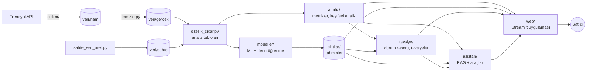
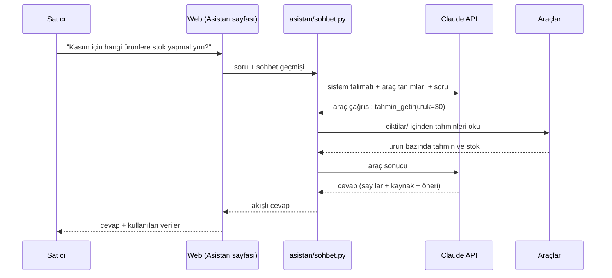
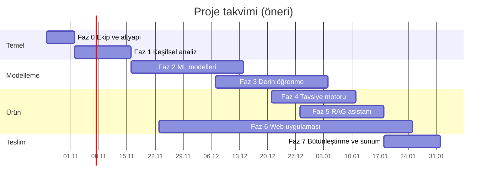

# Proje Planı — Trendyol Satıcı Karar Destek Sistemi

Bu doküman projenin yol haritasıdır: ne yapacağımızı, hangi sırayla ve "bitti"nin ne demek olduğunu tanımlar.
Görev durumları buradaki tablolarda tutulur.

- **Şu an neredeyiz, kim ne yapıyor?** → [DURUM.md](DURUM.md)
- **Nasıl çalışıyoruz (dal, commit, PR, devir)?** → [CONTRIBUTING.md](../CONTRIBUTING.md)
- **Veri ne içeriyor?** → [VERI_SOZLUGU.md](VERI_SOZLUGU.md) · **Tahminin doğruluğu nasıl ölçülür?** → [MODEL_DOGRULAMA.md](MODEL_DOGRULAMA.md)

---

## 1. Amaç

Bir Trendyol satıcısının kendi verisiyle, tek bir web uygulamasında:

1. **Bugünkü durumunu görmesi:** satış, ürün, müşteri, iade, kârlılık ve müşteri sesi.
2. **Geleceği görmesi:** talep, iade riski, kaybedilecek müşteri ve kampanya etkisi tahminleri.
3. **Ne yapması gerektiğini öğrenmesi:** öncelik sırasına konmuş, kanıtı ve beklenen etkisi (TL / %) belli tavsiyeler.
4. **Verisiyle konuşması:** RAG tabanlı asistan. Örnek: "Geçen ay iadeler neden arttı?", "Kasım için hangi ürünlere stok yapmalıyım?", "Bu ürüne %10 indirim yaparsam ne olur?"

### Proje sonunda başarı ölçütleri

| ölçüt | hedef |
|---|---|
| P1 modelleri | her biri baseline'ı geçmiş ve elimizdeki veriyle 2 seviyede doğrulanmış ([MODEL_DOGRULAMA.md](MODEL_DOGRULAMA.md)) |
| Derin öğrenme | en az 2 problemde klasik modelle dürüst karşılaştırma (geçemese bile raporlanır) |
| Tavsiye motoru | en az 10 tavsiye türü; her tavsiyenin kanıtı, beklenen etkisi ve güven düzeyi var |
| Asistan | değerlendirme setinde sayısal sorularda ≥ %90 doğru cevap, her cevapta kaynak (kullanılan veri) gösterimi |
| Web | sahte veriyle herkese açık demo; gerçek veriyle yalnızca yerelde |
| Süreç | her iş GitHub'da izlenebilir: görev → dal → PR → devir notu |

### Kapsam dışı
- Canlı mağazaya **yazma** (fiyat/stok değiştirme, soru cevaplama). Sistem salt okunurdur: önerir, uygulamaz.
- **Zamana bağlı doğrulama:** yeni veri gelmesini bekleyen ileriye dönük testler ve satıcıyla A/B deneyleri. Tüm analiz, tahmin ve doğrulama elimizdeki veriyle yapılır.
- Birden çok satıcıya hizmet veren yapı (multi-tenant): opsiyonel ileri adım.
- Mobil uygulama, kullanıcı hesabı ve ödeme sistemi.

---

## 2. Mevcut durum: tamamlanan temel

| bileşen | içerik |
|---|---|
| Veri çekimi (`cekim/`) | 6 betik: sipariş, ürün, soru, yorum, iade, finans. Artımlı çekim; kişisel veri diske yazılmıyor; `guncelle.py` ile günlük güncelleme |
| Veri hazırlama (`hazirlama/`) | 12 tablolu ortak şema; temizleme; sızıntısız kesim (`kesim_uygula`) |
| Sahte veri (`veri/sahte/`) | 2 yıllık, gerçeğe göre ayarlanmış, paylaşılabilir; gizli doğru cevaplar (`dogru_cevaplar/`) |
| Analiz tabloları | 9 tablo: günlük satış, ürün × gün, ürün/müşteri özeti, etkileşim, birlikte alım, aylık finans, beden iade analizi, satış detayı |
| Dokümanlar | README, veri sözlüğü, model doğrulama rehberi |

Gerçek veride ilk bulgular:
- Satılan birimlerin %11,8'i iade ediliyor; bu iadelerin %61'i beden kaynaklı.
- Soruların %68'i beden sorusu.
- Ürün maliyeti düşülmeden önce brüt satışın ~%51'i satıcıda kalıyor.
- En büyük giderler komisyon (%15) ve kargo (%10).

---

## 3. Sistem mimarisi

### Klasörler (Faz 1'den itibaren oluşturulacak)

| klasör | sorumluluk | faz |
|---|---|---|
| `analiz/` | metrik fonksiyonları (`metrikler.py`) ve tekrar kullanılabilir analiz fonksiyonları | 1 |
| `notebooks/` | keşif ve deney defterleri; `notebooks/<faz>/<görev-id>_<konu>.ipynb` | 1–3 |
| `modeller/` | `ortak/` (veri seti, backtest, metrikler, kayıt) + her model bir alt klasör | 2–3 |
| `ciktilar/<veri>/` | tahminler, durum raporu, tavsiyeler (`sahte/` veya `gercek/`) | 2–5 |
| `tavsiye/` | durum raporu ve tavsiye motoru | 4 |
| `asistan/` | bilgi tabanı indeksi, araçlar, sohbet döngüsü, değerlendirme seti | 5 |
| `web/` | Streamlit uygulaması (`web/app.py`, `web/sayfalar/`) | 6 |
| `tests/` | pytest testleri (sahte veriyle çalışır) | 0–7 |

### Mimari ilkeler
1. **Tek doğruluk kaynağı.** Bir metrik (ciro, iade oranı, katkı payı ...) tek bir yerde, `analiz/metrikler.py` içinde hesaplanır. Web, tavsiye motoru ve asistan aynı fonksiyonu çağırır; aynı soru her yerde aynı sayıyı verir.
2. **Sahte veriyle geliştir, gerçekle doğrula.** Her kod `veri="sahte"|"gercek"` parametresiyle iki veri setinde de çalışır.
3. **Katmanlar dosya üzerinden konuşur.** Modeller tahminlerini `ciktilar/` klasörüne yazar; web ve asistan bu dosyaları okur. İstek anında model eğitilmez.
4. **Sistem salt okunurdur.** Asistan dahil hiçbir bileşen Trendyol'a yazmaz.
5. **Kişisel veri yok.** Ham veride bile yok (`cekim/anonim.py`). LLM'e giden veri toplulaştırılmış iş verisidir.

---

## 4. Fazlar ve görevler

**Durum:** ⬜ bekliyor · 🟨 devam ediyor · 🟦 incelemede (PR açık) · ✅ bitti · ⛔ engelli

**Öncelik:** **P1** olmazsa olmaz · **P2** olmalı · **P3** olursa iyi

**Görev seçme kuralı:** bağımlılıkları ✅ olan en yüksek öncelikli ⬜ görevi al. Üstlenirken "Sorumlu" ve "Durum" sütunlarını güncelle (bkz. [CONTRIBUTING.md](../CONTRIBUTING.md#3-görev-üstlenme-ve-devir)).

### Faz 0 — Ekip ve altyapı (Hafta 1)

| ID | görev | öncelik | bağımlı | çıktı | sorumlu | durum |
|---|---|---|---|---|---|---|
| F0-01 | GitHub deposu (private), ilk push, ekip üyelerini collaborator ekle, `main` dalını koru (PR zorunlu) | P1 | — | depo bağlantısı DURUM.md'de | Tahir | ⬜ |
| F0-02 | Herkes kurulumu sıfırdan yapar, `python guncelle.py --sahte` çalıştırır, dokümanları okur | P1 | F0-01 | her üye DURUM.md'ye adını ekler | herkes | ⬜ |
| F0-03 | Ortak Python sürümünü sabitle (öneri: 3.12, DL kütüphaneleriyle uyum), `requirements-dev.txt` (pytest, ruff, jupyter, nbstripout) | P1 | F0-01 | güncel README kurulum bölümü | — | ⬜ |
| F0-04 | GitHub Actions: her PR'da yasaklı dosya kontrolü (`.env`, `veri/ham`, `veri/gercek`, `ciktilar/gercek`), `ruff`, `pytest` | P1 | F0-03 | `.github/workflows/kontrol.yml` | — | ⬜ |
| F0-05 | Görevleri GitHub Issue olarak aç, GitHub Projects panosu kur (Bekliyor / Devam / İncelemede / Bitti) | P2 | F0-01 | pano bağlantısı DURUM.md'de | — | ⬜ |
| F0-06 | İlk testler: iki veri setinin şema eşitliği, kesim sızıntı testi, `guncelle.py --sahte` duman testi | P2 | F0-03 | `tests/test_veri.py` | — | ⬜ |

### Faz 1 — Veri anlama ve keşifsel analiz (Hafta 2–3)

| ID | görev | öncelik | bağımlı | çıktı | sorumlu | durum |
|---|---|---|---|---|---|---|
| F1-01 | Metrik sözlüğü: her KPI'ın tanımı, formülü, tablo/sütunu (ciro, net satış, sipariş, ort. sepet, iade oranı (birim/tutar), iptal, katkı payı, tekrar alım, cevap süresi ...) | P1 | F0-02 | `docs/METRIKLER.md` | — | ⬜ |
| F1-02 | `analiz/metrikler.py`: metrik fonksiyonları (tarih aralığı + kırılım parametreli) ve testleri | P1 | F1-01 | modül + `tests/test_metrikler.py` | — | ⬜ |
| F1-03 | Veri kalitesi raporu: eksik/aykırı değerler, eşleşme oranları, gerçek–sahte dağılım karşılaştırması | P1 | F0-02 | notebook + özet | — | ⬜ |
| F1-04 | Keşif: satış ve zaman (trend, mevsim, haftanın günü, saat, kampanya günleri) | P1 | F1-02 | notebook + bulgular | — | ⬜ |
| F1-05 | Keşif: ürün ve kategori (ABC/Pareto, fiyat, renk/beden talebi, stok) | P1 | F1-02 | notebook + bulgular | — | ⬜ |
| F1-06 | Keşif: müşteri ve coğrafya (RFM dağılımı, tekrar alım, il bazında satış/iade/kargo süresi) | P2 | F1-02 | notebook + bulgular | — | ⬜ |
| F1-07 | Keşif: iade ve beden (neden dağılımı, kategori/beden bazında iade, kalıp sinyali) | P1 | F1-02 | notebook + bulgular | — | ⬜ |
| F1-08 | Keşif: finans ve kârlılık (kâr-zarar şelalesi, gider kalemleri, ürün katkı payı, desi) | P1 | F1-02 | notebook + bulgular | — | ⬜ |
| F1-09 | Keşif: kampanya, indirim ve reklam (indirim türleri, kupon dönemleri, reklam–satış) | P2 | F1-02 | notebook + bulgular | — | ⬜ |
| F1-10 | Keşif: müşteri sesi (soru konuları, puan dağılımı, cevap süresi, sık geçen kelimeler) | P2 | F1-02 | notebook + bulgular | — | ⬜ |
| F1-11 | Faz 1 özeti: "Mağazanın bugünkü durumu" (ilk 15–20 içgörü). Web'deki Genel Bakış sayfasının içeriği | P1 | F1-04…F1-10 | `docs/rapor/01_durum.md` | — | ⬜ |

### Faz 2 — Makine öğrenimi modelleri (Hafta 4–7)

Her model görevi için: baseline karşılaştırması, elimizdeki veriyle 2 seviyeli doğrulama (sahte veride doğru cevaplar + geriye dönük zaman testi), model kartı (`docs/modeller/<ID>.md`) ve standart tahmin çıktısı (`ciktilar/<veri>/tahminler/<ID>.csv`).

| ID | görev | öncelik | bağımlı | çıktı | sorumlu | durum |
|---|---|---|---|---|---|---|
| F2-01 | Model altyapısı `modeller/ortak/`: kesimli eğitim seti (özellik + hedef), kayan pencere backtest, metrikler, baseline'lar, model kayıt/yükleme, tahmin çıktısı formatı, model kartı şablonu | P1 | F1-02 | modül + şablon | — | ⬜ |
| F2-02 | Mağaza günlük satış tahmini (mevsimsel naive → LightGBM), 30 gün ufuk | P1 | F2-01 | tahmin + model kartı | — | ⬜ |
| F2-03 | Ürün bazında talep tahmini (global LightGBM) + stok tükenme tarihi | P1 | F2-01 | tahmin + model kartı | — | ⬜ |
| F2-04 | Satır bazında iade riski (LightGBM + kalibrasyon) | P1 | F2-01 | tahmin + model kartı | — | ⬜ |
| F2-05 | Beden ve kalıp: model × beden kalıp eğilimi, boy-kilo → beden önerisi (sahtede %77 kuralını geç) | P1 | F2-01 | tahmin + model kartı | — | ⬜ |
| F2-06 | Fiyat ve indirim esnekliği (log-log, ürün/kategori bazında; sahtede gerçek esnekliği bul) | P2 | F2-01 | katsayılar + model kartı | — | ⬜ |
| F2-07 | Müşteri segmentasyonu (RFM + K-Means/GMM) ve kayıp (churn) tahmini | P2 | F2-01 | segmentler + model kartı | — | ⬜ |
| F2-08 | Müşteri yaşam boyu değeri (BG/NBD + Gamma-Gamma) | P3 | F2-07 | tahmin + model kartı | — | ⬜ |
| F2-09 | Birlikte alım ve öneri baseline'ı (FP-Growth, item2vec, popülerlik) | P2 | F2-01 | öneri listeleri + model kartı | — | ⬜ |
| F2-10 | Ürün portföy skorlaması (yıldız / sorunlu / ölü stok kümeleri) + anomali tespiti | P2 | F2-01 | ürün skorları + model kartı | — | ⬜ |
| F2-11 | Reklam etkisi (adstock + regresyon; sahtede reklam çarpanını bul) | P3 | F2-01 | katsayılar + model kartı | — | ⬜ |
| F2-12 | Kârlılık ve senaryo simülatörü ("iade %5 düşerse", "desi 1 azalırsa", "indirim %10 olursa"), ürün maliyeti girişi | P1 | F1-08 | `analiz/senaryo.py` | — | ⬜ |

### Faz 3 — Derin öğrenme (Hafta 7–10)

| ID | görev | öncelik | bağımlı | çıktı | sorumlu | durum |
|---|---|---|---|---|---|---|
| F3-01 | Etiketleme: gerçek yorum, soru ve iade notlarından 200–300 örnek elle etiketlenir (duygu, konu). Etiketler gerçek veridir, yerelde kalır | P1 | F1-10 | `veri/gercek/etiketler/` (yerel) | Tahir + 1 kişi | ⬜ |
| F3-02 | Duygu analizi: BERTurk ince ayarı ile TF-IDF + lojistik regresyon baseline karşılaştırması | P1 | F3-01 | model + model kartı | — | ⬜ |
| F3-03 | Konu sınıflandırma (soru konusu, iade notu nedeni): BERTurk vs kural tabanlı | P1 | F3-01 | model + model kartı | — | ⬜ |
| F3-04 | Sorulardan bilgi çıkarma (boy, kilo, istenen kalıp) → F2-05'e bağla; otomatik cevap önerisi | P2 | F3-03, F2-05 | model + model kartı | — | ⬜ |
| F3-05 | Derin talep tahmini: LSTM/GRU ve TFT (veya N-BEATS) vs F2-03 LightGBM | P1 | F2-03 | model + karşılaştırma | — | ⬜ |
| F3-06 | Derin iade riski: embedding'li MLP / TabNet vs F2-04 | P2 | F2-04 | model + karşılaştırma | — | ⬜ |
| F3-07 | Derin öneri: NCF / two-tower vs F2-09 | P3 | F2-09 | model + karşılaştırma | — | ⬜ |
| F3-08 | Autoencoder ile müşteri/ürün temsilleri ve anomali | P3 | F2-10 | model + model kartı | — | ⬜ |
| F3-09 | Klasik ve derin modellerin karşılaştırma raporu | P1 | F3-02, F3-05 | `docs/rapor/03_model_karsilastirma.md` | — | ⬜ |

GPU gerekirse Google Colab **yalnızca sahte veriyle** kullanılır; gerçek veri buluta yüklenmez.

### Faz 4 — İçgörü ve tavsiye motoru (Hafta 9–11)

| ID | görev | öncelik | bağımlı | çıktı | sorumlu | durum |
|---|---|---|---|---|---|---|
| F4-01 | Tavsiye şeması: id, tür, başlık, açıklama, kanıt (metrik/model + değerler), beklenen etki (TL/%), güven, öncelik, ilgili ürün/segment, önerilen aksiyon | P1 | F1-02 | `tavsiye/sema.py` | — | ⬜ |
| F4-02 | Durum raporu üretici: sağlık skoru, KPI özeti, önceki döneme göre dikkat çeken değişimler | P1 | F1-11 | `ciktilar/<veri>/durum_raporu.json` | — | ⬜ |
| F4-03 | Tavsiye kuralları (en az 10): stok tükenme riski, kalıbı dar ürün, zarar eden ürün, iade artışı alarmı, kampanya fırsatı, indirimin marjı yemesi, kayıp riskli segment, çapraz satış paketi, geç cevaplanan sorular, kargo desisi, reklam bütçesi, sezon hazırlığı, düşük puanlı ürün | P1 | F4-01, F2-* | `tavsiye/kurallar/` | — | ⬜ |
| F4-04 | Önceliklendirme (beklenen etki × güven) ve çakışan tavsiyeleri birleştirme | P1 | F4-03 | `ciktilar/<veri>/tavsiyeler.json` | — | ⬜ |
| F4-05 | Tavsiye doğrulama: sahtede doğru cevaplarla (ör. "dar" tavsiyesi gerçekten dar ürünlerde mi), gerçekte satıcıyla gözden geçirme | P1 | F4-04 | `docs/rapor/04_tavsiye_dogrulama.md` | — | ⬜ |

### Faz 5 — RAG asistanı: "verinle konuş" (Hafta 10–12)

Tasarım ayrıntısı bölüm 5'te.

| ID | görev | öncelik | bağımlı | çıktı | sorumlu | durum |
|---|---|---|---|---|---|---|
| F5-01 | Mimari kararı: LLM, embedding, vektör deposu; maliyet ve gizlilik değerlendirmesi; `ANTHROPIC_API_KEY` için `.env.example` | P1 | — | karar kaydı (bölüm 8) | — | ⬜ |
| F5-02 | Bilgi tabanı: veri ve metrik sözlükleri, durum raporu, tavsiyeler, model kartları, ürün/kategori/ay özet metinleri → parçalama, embedding, indeks; veri güncellenince yeniden indeksleme | P1 | F5-01, F4-02 | `asistan/indeks.py` | — | ⬜ |
| F5-03 | Araçlar: `sql_sorgula` (DuckDB, salt okunur, izinli tablolar, satır sınırı), `metrik_hesapla`, `tahmin_getir`, `senaryo_calistir`, `tavsiyeleri_getir`, `bilgi_ara` | P1 | F1-02, F2-12 | `asistan/araclar.py` + testler | — | ⬜ |
| F5-04 | Sohbet döngüsü: sistem talimatı (yalnızca veriye dayan, sayının kaynağını göster, emin değilsen söyle, Türkçe), araç döngüsü, akışlı cevap, sohbet geçmişi, maliyet sınırı | P1 | F5-03 | `asistan/sohbet.py` | — | ⬜ |
| F5-05 | Değerlendirme seti: 40–60 soru (sayısal, karşılaştırma, "neden", "ne yapmalıyım"); beklenen cevaplar metrik fonksiyonlarından otomatik; doğruluk, kaynak gösterme, uydurma oranı | P1 | F5-04 | `asistan/degerlendirme/` | — | ⬜ |
| F5-06 | Güvenlik testleri: SQL ile yazma denemesi, yorum metinlerine gömülü talimat (prompt injection), maliyet sınırı | P1 | F5-04 | `tests/test_asistan_guvenlik.py` | — | ⬜ |

### Faz 6 — Web uygulaması (Hafta 5–13, diğer fazlarla paralel)

| ID | görev | öncelik | bağımlı | çıktı | sorumlu | durum |
|---|---|---|---|---|---|---|
| F6-01 | Teknoloji kararı: Streamlit (öneri) veya FastAPI + React | P1 | — | karar kaydı (bölüm 8) | — | ⬜ |
| F6-02 | İskelet: sayfa yapısı, tema, veri seti seçici (sahte/gerçek), önbellek, ortak bileşenler (KPI kartı, grafik, tablo) | P1 | F6-01, F1-02 | `web/app.py` | — | ⬜ |
| F6-03 | Genel Bakış: durum raporu, KPI'lar, uyarılar | P1 | F6-02, F4-02 | sayfa | — | ⬜ |
| F6-04 | Satış ve Tahmin | P1 | F6-02, F2-02, F2-03 | sayfa | — | ⬜ |
| F6-05 | Ürünler (portföy + ürün detay sayfası) | P1 | F6-02, F2-10 | sayfa | — | ⬜ |
| F6-06 | Müşteriler (segmentler, coğrafya) | P2 | F6-02, F2-07 | sayfa | — | ⬜ |
| F6-07 | İadeler ve Beden | P1 | F6-02, F2-04, F2-05 | sayfa | — | ⬜ |
| F6-08 | Finans ve Kârlılık + senaryo simülatörü | P1 | F6-02, F2-12 | sayfa | — | ⬜ |
| F6-09 | Kampanya ve Reklam | P2 | F6-02, F2-06 | sayfa | — | ⬜ |
| F6-10 | Müşteri Sesi (yorum/soru analizi) | P2 | F6-02, F3-02 | sayfa | — | ⬜ |
| F6-11 | Tavsiyeler: aksiyon listesi, filtre, "uygulandı" işareti | P1 | F6-02, F4-04 | sayfa | — | ⬜ |
| F6-12 | Asistan: sohbet arayüzü, kullanılan verilerin gösterimi | P1 | F6-02, F5-04 | sayfa | — | ⬜ |
| F6-13 | Demo yayını: sahte veriyle Streamlit Community Cloud (gerçek veri asla) | P2 | F6-03…F6-12 | demo bağlantısı | — | ⬜ |

### Faz 7 — Bütünleştirme, test ve teslim (Hafta 13–14)

| ID | görev | öncelik | bağımlı | çıktı | sorumlu | durum |
|---|---|---|---|---|---|---|
| F7-01 | Uçtan uca hat: `guncelle.py` → modelleri yeniden eğit / tahmin et → tavsiye → indeks → web | P1 | F2–F6 | tek komut | — | ⬜ |
| F7-02 | Testler ve CI yeşil; gerçek veriyle son çalıştırma (yerel) | P1 | F7-01 | test raporu | Tahir | ⬜ |
| F7-04 | Final rapor, sunum ve demo videosu | P1 | F7-01 | `docs/rapor/`, sunum | herkes | ⬜ |
| F7-05 | Satıcı için kullanım kılavuzu ve geliştirici devir dokümanı | P2 | F7-01 | `docs/KULLANIM.md` | — | ⬜ |

---

## 5. RAG asistanı tasarımı

### Neden "sadece RAG" yetmez
Klasik RAG'da sorunun benzerine metin parçaları aranır ve model onları okuyup cevap verir. "Geçen ay kaç iade oldu?" gibi **sayısal** sorularda bu yöntem güvenilmezdir: sayı bir metin parçasında yoksa model tahmin eder.

Bu yüzden **hibrit** bir yapı kuruyoruz:
- **Bilgi tabanı araması:** tanımlar, raporlar, tavsiye açıklamaları ve model kartları için. "Katkı payı nedir?", "Bu tavsiyeyi neden verdin?" gibi sorular.
- **Araçlar:** sayılar her zaman koddan gelir. SQL sorgusu, metrik fonksiyonu, model tahmini ve senaryo simülasyonu. "Kaç?", "Hangisi?", "Ne olur?" gibi sorular.

Model hangi aracı kullanacağına kendisi karar verir. Cevapta kullandığı veriyi (tablo, filtre, sayı) gösterir.

### Teknik öneriler (F5-01'de kesinleşecek)

| konu | öneri | not |
|---|---|---|
| Dil modeli | Claude Opus 5.5 (`claude-opus-5-5`), Anthropic Python SDK (`anthropic`) | Daha ucuz seçenekler: Claude Sonnet 5.5 (`claude-sonnet-5-5`) ve Claude Haiku 5.5 (`claude-haiku-5-5`). Model değişikliği ekip kararıdır ve değerlendirme setiyle (F5-05) ölçülerek yapılmalıdır |
| Araç döngüsü | SDK'nın Tool Runner'ı (`client.beta.messages.tool_runner` + `@beta_tool`); araç şemalarında `strict: true` | Opus 5.5'te belirli bir aracı zorlamak (`tool_choice: any/tool`) desteklenmiyor; yönlendirme sistem talimatıyla yapılır |
| Düşünme ve effort | Opus 5.5'te düşünme her zaman açık; derinlik `output_config.effort` ile ayarlanır (varsayılan `medium`) | Sohbet için `low`/`medium` ile başla, değerlendirme setiyle ayarla |
| Akış | Cevaplar akışlı (streaming) verilir | Web'de cevap kelime kelime görünür |
| Önbellekleme | Sabit kısımlar başta ve `cache_control` ile önbellekte: sistem talimatı, araç tanımları, veri sözlüğü özeti. Değişen kısım (soru, tarih) en sonda | `usage.cache_read_input_tokens` ile isabet kontrol edilir |
| Embedding | Yerel çok dilli model (sentence-transformers ailesinden, ör. multilingual-e5); vektör deposu Chroma veya FAISS | Ücretsiz; bilgi tabanı bilgisayardan çıkmaz |
| SQL aracı | DuckDB, CSV tablolarına salt okunur bağlantı; yalnızca `SELECT`; izinli tablo listesi; satır sınırı ve zaman aşımı | Yazma ve dosya erişimi engellenir |
| Güvenlik | Yorum ve soru metinleri müşteri yazısıdır: araç sonucunda **veri** olarak işaretlenir, talimat olarak değil | F5-06'da test edilir |
| Reddetme | Her cevapta `stop_reason` kontrolü (`refusal`) | Sunucu tarafı yedek model (fallback) seçeneği F5-04'te değerlendirilir |

### Maliyet (tahmini, F5-04'te ölçülecek)
- Fiyatlar: Opus 5.5'te 1 milyon token için girdi $4, çıktı $20, önbellekten okuma $0,20.
- Bir soru tahminen ~20 bin token sabit kısım (önbellekte), ~5 bin token araç sonucu ve ~1-3 bin token çıktı + düşünme kullanır.
- Bu varsayımlarla soru başına **~0,05–0,10 $** düşer; 50 soruluk bir değerlendirme turu **~3–5 $** eder.
- Gerçek değer `response.usage` ile ölçülüp DURUM.md'ye yazılmalı.
- **Açık soru:** API anahtarı ve bütçe kimde olacak? (DURUM.md → engeller)

### Gizlilik
- LLM'e giden veri, kişisel veri içermeyen toplulaştırılmış iş verisidir (ciro, ürün, iade oranı ...).
- Yine de gerçek mağaza verisi bir dış servise gönderilmiş olur. Demo sahte veriyle yapılır; gerçek veriyle kullanım satıcının onayıyla ve yerelde olur.

---

## 6. Takvim (öneri)

Takvim 26 Ekim 2026 başlangıcına göre yazıldı. Dönem bitişinize göre kaydırın.

| kilometre taşı | zaman | hocaya gösterilecek |
|---|---|---|
| K1 | Hafta 3 sonu | metrik sözlüğü + "mağazanın bugünkü durumu" raporu |
| K2 | Hafta 7 sonu | P1 ML modelleri doğrulanmış (model kartlarıyla) |
| K3 | Hafta 10 sonu | derin öğrenme modelleri + klasik/derin karşılaştırma |
| K4 | Hafta 12 sonu | tavsiye motoru + çalışan asistan |
| K5 | Hafta 14 sonu | web demosu + final rapor ve sunum |

---

## 7. Roller

Ekip küçük olduğu için roller **alan sorumluluğudur**, görevi kimin yapacağını kısıtlamaz. Herkes her görevi alabilir. Alan sorumlusu o alandaki PR'ları inceler ve kararları takip eder.

| rol | alan | kişi |
|---|---|---|
| Proje sahibi | gerçek veri, `.env`, gerçek veride doğrulama, son birleştirme | Tahir |
| Veri ve analiz | Faz 1, `analiz/`, metrik sözlüğü | — |
| Modelleme | Faz 2–3, `modeller/` | — |
| Asistan | Faz 5, `asistan/` | — |
| Web | Faz 6, `web/` | — |

Gerçek veri ve API anahtarı yalnızca proje sahibindedir. Diğer üyeler sahte veriyle çalışır; gerçek veride çalıştırılması gereken adımlar "sorumlu: Tahir" olarak işaretlidir.

---

## 8. Kararlar

Önemli teknik kararlar buraya bir satırla yazılır. Karar değişirse yeni satır eklenir, eskisi silinmez.

| no | karar | durum | gerekçe |
|---|---|---|---|
| K-01 | Sahte veriyle geliştir, gerçek veriyle doğrula | alındı | gerçek veri az ve gizli; sahte veride doğru cevaplar biliniyor |
| K-02 | Kişisel veri diske yazılmaz (`cekim/anonim.py`) | alındı | KVKK veri minimizasyonu |
| K-03 | Kod ve dokümanlarda Türkçe isimlendirme | alındı | mevcut kodla tutarlılık |
| K-04 | Metrikler tek yerde (`analiz/metrikler.py`) | alındı | web, tavsiye ve asistanda aynı sayılar |
| K-05 | PR'lar "squash" edilmeden birleştirilir | alındı | hoca her commit'i görebilsin |
| K-06 | Web: Streamlit | öneri (F6-01) | tamamen Python, hızlı geliştirme, hazır sohbet bileşeni; alternatif FastAPI + React daha esnek ama ekip için daha uzun |
| K-07 | Asistan: Claude API + araç kullanımı + yerel embedding | öneri (F5-01) | sayılar araçlardan, metinler bilgi tabanından; embedding ücretsiz ve yerel |
| K-08 | Ortak Python sürümü 3.12 | öneri (F0-03) | derin öğrenme kütüphaneleriyle uyum |
| K-09 | Zamana bağlı doğrulama (ileriye dönük test, A/B deneyi) kapsam dışı; görev F2-13 ve F7-03 kaldırıldı | alındı | proje kısa vadeli; tüm sonuçlar elimizdeki veriyle elde edilir |

---

## 9. Riskler

| risk | etki | önlem |
|---|---|---|
| Gerçek sipariş geçmişi kısa (Temmuz 2026'dan beri) | zaman serisi tahminleri gerçek veride kısa dönemle sınırlı | uzun dönem için finans tablosundaki 1 yıllık satış kayıtları; yöntem 2 yıllık sahte veride doğrulanır; sonuçlar sınırlarıyla birlikte raporlanır |
| Sahte veride modelin "başarılı" görünmesi | yanıltıcı sonuç | sahte veri yalnızca yöntemi doğrular; sonuçlar gerçek veride raporlanır |
| Kütüphane / Python sürümü uyumsuzluğu | kurulum kaybı | ortak sürüm (F0-03), `requirements` sabitlenir |
| GPU yok | derin öğrenme yavaş | küçük modeller, Colab (yalnızca sahte veri) |
| LLM maliyeti | bütçe aşımı | önbellekleme, maliyet sınırı, değerlendirme setiyle model/effort seçimi |
| Asistanın sayı uydurması | güven kaybı | sayılar yalnızca araçlardan; değerlendirme seti (F5-05) |
| Devirde bilgi kaybı | iş tekrarı, gecikme | devir protokolü, günlük push, DURUM.md (CONTRIBUTING.md §3) |
| Kapsamın büyüklüğü | yetişmeme | P1 → P2 → P3 sırası; P3'ler gerekirse kesilir |
| Gerçek veri veya API anahtarının GitHub'a gitmesi | gizlilik ihlali | `.gitignore`, CI kontrolü (F0-04), PR kontrol listesi |
| Gerçek veriyle çalıştırılmış notebook çıktısının commitlenmesi | veri sızıntısı | notebook kuralı: yalnızca sahte veri çıktısı veya `nbstripout` |

---

## 10. Bu plan nasıl güncellenir

- Plan PR ile değişir. Görev üstlenme veya bitirme, kendi PR'ının içinde yapılır.
- Yeni görev, ilgili fazın sonuna yeni ID ile eklenir. Mevcut ID'ler **asla yeniden numaralandırılmaz**, çünkü dal adları, commit'ler ve devir notları ID'lere bağlı.
- Vazgeçilen görev silinmez; durumuna "~~üstü çizili~~ (iptal: gerekçe)" yazılır.
- Takvim kayarsa bölüm 6 güncellenir ve DURUM.md'de not düşülür.
